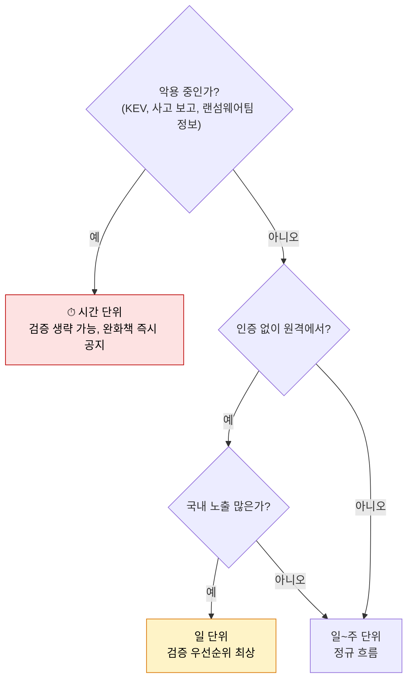

# 입수·분석 단계에서 쓰는 기술

| 레벨 | 상태 | 최종 개정 |
|---|---|---|
| 🟢 | 📝 초안 | 2026-10-22 |

> **한눈에 보기**
> 입수·분석 단계의 질문은 셋이다. **이미 알려진 것인가**, **국내에 영향이 있는가**, **얼마나 급한가**.
> 세 질문은 각각 제2편의 분류 체계, 정보 수집, 위협 모델링으로 답한다.
> 이 단계에서 잘 거르면 뒤의 검증·조치 부담이 절반으로 준다.

## 1. 이 단계가 받는 것

[제1편 업무 흐름](../../vol1-center/01-understanding/04-workflow.md)의 ①②. 입구는 넷이다.

| 입구 | 들어오는 형태 | 첫 처리 |
|---|---|---|
| 신고포상제 | 포털 신고서 (재현 절차, 영향, 환경) | 중복 확인 → 신규 판단 |
| 118 외부 신고 | 전화·메일. 형식 없음 | 재현 절차 요청부터 |
| 유관기관 공유 | CVE 번호, 권고문 | 국내 영향 분석 |
| 내부 입수 (사고 분석, 점검, AI 탐지) | IoC, 크래시, 스캐너 출력 | 취약점 유형 식별 |

## 2. 질문 1: 이미 알려진 것인가

**쓰는 기술**: [CWE·CVE·CVSS 체계](../../vol2-tech/part1-foundations/02-cwe-cve-cvss.md)

1. 제품명과 버전을 정확히 적는다. "OO 솔루션"이 아니라 "OO 솔루션 3.2.1 Windows 빌드".
2. CVE 검색: NVD, 제조사 권고, 국내 식별 체계 🔎. 같은 제품·같은 유형·겹치는 버전이면 중복 후보.
3. **중복이지만 새 경로**일 수 있다. 같은 CWE라도 다른 함수, 다른 입력 지점이면 신규다. 제보의 재현 절차와 기존 CVE의 설명을 **코드 위치 수준**에서 비교한다.
4. 판단을 기록한다. "CVE-XXXX와 동일 (동일 함수, 동일 입력)" 또는 "CVE-XXXX와 유형 동일하나 입력 지점 상이 → 신규".

> 🟡 CVSS 점수는 **참고**다. 제조사가 매긴 점수는 자사 기준이고, 국내 맥락이 빠져 있다. 질문 2로 넘어가기 전에 점수에 끌려가지 않는다.

## 3. 질문 2: 국내에 영향이 있는가

**쓰는 기술**: [정보 수집](../../vol2-tech/part2-methodology/02-recon.md), [공격 표면](../../vol2-tech/part1-foundations/03-attack-surface.md)

| 확인할 것 | 어떻게 | 출처 |
|---|---|---|
| 국내 사용 규모 | 공공 조달 내역, 기반시설 자산 목록 🔎, 인터넷 노출 검색(허가된 범위), 과거 점검 기록 | 내부 자산 DB 🔎 |
| 사용 분야 | 기반시설·공공·금융·다수 국민 중 어디인가 | [유관기관](../../vol1-center/03-partners/11-external.md) 소관 구분 |
| 기본 설정에서 취약한가 | 취약 기능이 기본 활성인가, 별도 설정 필요한가 | 제조사 문서, 재현 환경 |
| 대체·완화 가능성 | 패치 없이도 막을 수 있는가 | [방어 섹션](../../vol2-tech/part3-web/01-sql-injection.md) (각 유형 장의 6절) |

해외에서 Critical이어도 국내 설치가 없으면 우선순위가 낮다. 반대로 해외에선 조용해도 국내 특정 제품에 널리 쓰이면 높다. **이 판단이 센터가 존재하는 이유 중 하나다.**

## 4. 질문 3: 얼마나 급한가

**쓰는 기술**: [위협 모델링](../../vol2-tech/part2-methodology/03-threat-modeling.md)



악용 중인 취약점은 **검증을 기다리지 않는다**. 완화책(설정 변경, 네트워크 차단, 기능 비활성)을 먼저 공지하고 검증은 병행한다. [제1편 1장](../../vol1-center/01-understanding/01-why.md)의 "공개 당일 악용 29%"가 이 규칙의 근거다.

## 5. AI 1차 분석과의 역할 분담

[AI 활용](../../vol1-center/02-programs/09-ai.md)에서 설명한 구조가 이 단계에 적용된다.

| AI가 잘하는 것 | 사람이 해야 하는 것 |
|---|---|
| CVE 중복 후보 찾기 | 코드 위치 수준의 동일성 판단 |
| 제보 형식 정리, 누락 항목 지적 | 신고자에게 무엇을 더 요청할지 결정 |
| 유형(CWE) 분류 제안 | 국내 사용 현황과 급박도 판단 |

## 6. 이 단계의 산출물

```
## 접수 기록
- 입구: 신고포상제 / 118 / 유관기관 / 내부
- 제품·버전:
- 유형(CWE):
- 중복 판단: 신규 / CVE-XXXX 동일 / CVE-XXXX 유형 동일·경로 상이
- 국내 영향: 사용 규모 · 분야 · 기본 설정 취약 여부
- 급박도: 시간 / 일 / 주  (근거:)
- 다음 단계: 검증 담당 · 기한
```

🔎 센터 양식으로 대체한다.

## 체크리스트

- [ ] 제품명과 버전을 정확한 문자열로 적었는가?
- [ ] 중복 판단을 코드 위치 수준에서 했는가?
- [ ] 국내 사용 규모·분야·기본 설정을 확인했는가?
- [ ] 악용 중 여부를 가장 먼저 확인했는가?

## 변경 이력

| 날짜 | 변경 | 기여자 |
|---|---|---|
| 2026-10-22 | 초안 작성 | @anthonynoh5202 |
