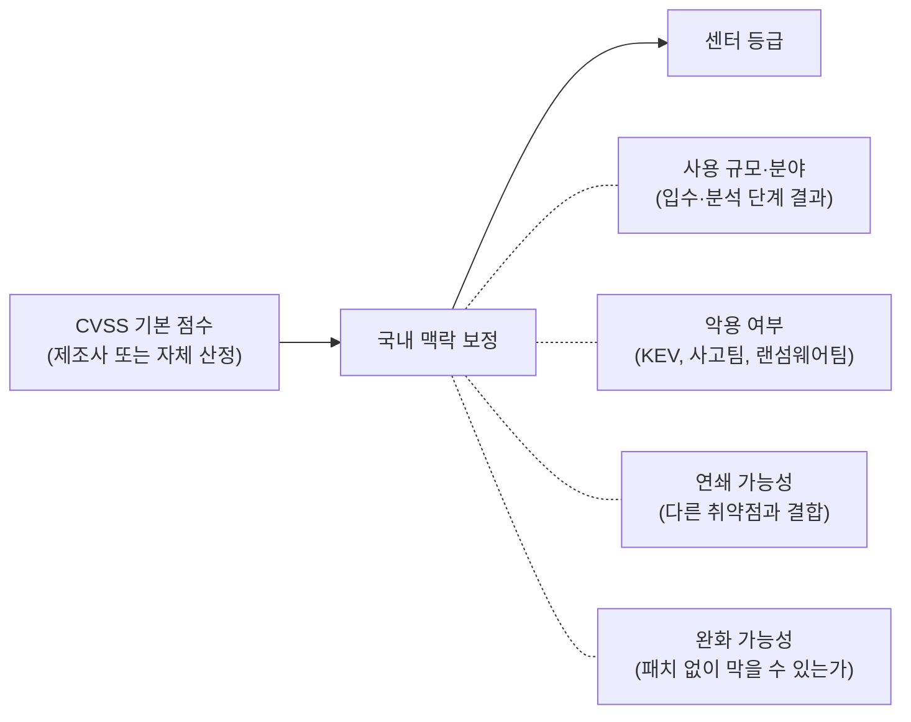
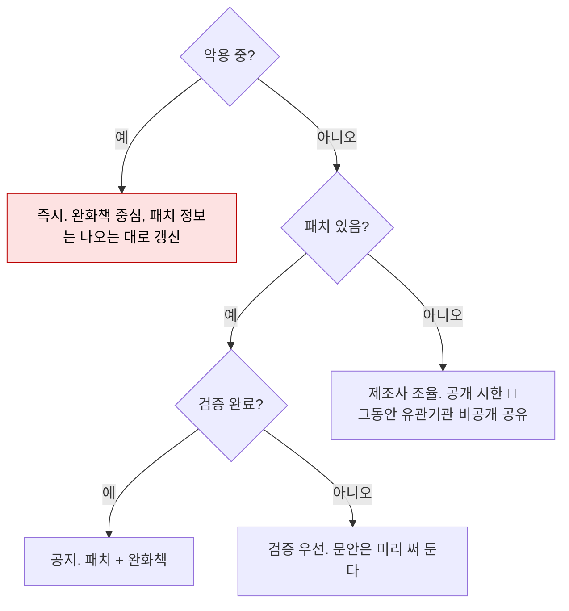

# 공유·공지 단계: 영향도와 문안

| 레벨 | 상태 | 최종 개정 |
|---|---|---|
| 🟡 | 🔄 개정중 | 2026-10-23 |

> **한눈에 보기**
> 공지는 센터의 분석 결과가 국민과 기업에게 직접 닿는 거의 유일한 통로이고(발행 주체는 🔎, [제1편 2부 7장](../../vol1-center/02-programs/07-portal-advisory.md) 1절), 센터가 평가받는 기준이다.
> 두 가지 판단이 필요하다. **얼마나 심각한가**(영향도)와 **언제, 누구에게**(범위와 시점).
> "공지가 늦다"는 불만의 해법은 앞 단계를 빨리 하는 것과, 문안을 **분석과 동시에 초안**으로 쓰는 것이다.

## 1. 영향도: CVSS에 국내 맥락을 더한다

**쓰는 기술**: [영향도 산정](../../vol2-tech/part8-reporting/02-severity.md)

| 상황 | CVSS | 센터 등급 | 이유 |
|---|---|---|---|
| 해외 Critical, 국내 설치 거의 없음 | 9.8 | 중 | 파급도 낮음 |
| 중간 점수, 국내 기반시설에 널리 사용, 악용 중 | 6.5 | 긴급 | 악용 + 파급도 |
| 인증 필요, 하지만 기본 계정이 널리 알려짐 | 7.2 | 높음 | 연쇄 (기본 계정 + 취약점) |

과장도 축소도 신뢰를 깎는다. 같은 판단을 다음 건에도 하려면 **보정 이유를 기록**한다. 🔎 센터 등급 체계

## 2. 범위: 누구에게

| 범위 | 대상 | 채널 | 기준 |
|---|---|---|---|
| 유관기관 공유 | 소관 기관(국정원, 금보원 등), 기반시설 담당 | 🔎 공유 체계 | 해당 분야 영향 |
| 기업 개별 통보 | 영향받는 사용 기업 | 조치 요청 ([3장](03-remediation.md)) | 사용 확인된 기관 |
| 대국민 보안공지 | 전체 | 보호나라 | 파급력 큼 📎 |
| 비공개 유지 | | | 패치 전, 악용 안 됨, 공개 시 악용 가속 |

타 소관 분야 정보는 해당 기관에 **이관**한다. [제1편 1부 1장](../../vol1-center/01-understanding/01-why.md) 4절.

**공유 등급.** 유관기관에 보내는 정보에는 수신자가 어디까지 다시 공유해도 되는지를 표시한다. 국제 CERT 커뮤니티의 표준은 FIRST의 TLP(Traffic Light Protocol) 2.0이다([부록 A](../../appendix/a-glossary.md)). 표시는 네 색(RED·AMBER·GREEN·CLEAR)에 AMBER의 하위 표시 하나(AMBER+STRICT)를 더한 다섯이다. 📎 [FIRST TLP 2.0](https://www.first.org/tlp/)

| 등급 | 수신자가 다시 공유할 수 있는 범위 | 취약점 정보에서 쓰일 상황(예) |
|---|---|---|
| TLP:RED | 그 정보를 받은 자리(회의·대화·전달)의 참여자만. 같은 조직 안에서도 그 밖의 사람에게 공유 불가 | 패치 전이고 악용 가능한 정보를 특정 담당자에게만 알릴 때 |
| TLP:AMBER+STRICT | 수신자의 조직 안에서만 | 패치 전 정보를 소관 기관에 공유할 때 |
| TLP:AMBER | 수신자의 조직 안과, 보호를 위해 알아야 하는 그 고객(client)까지. 알 필요가 있는 사람(need-to-know)으로 한정 | 기반시설 담당 기관이 산하 사업자에게 전파해야 할 때 |
| TLP:GREEN | 수신자가 속한 커뮤니티(동종 기관) 안에서. 공개 채널에는 올리지 않음 | 대국민 공지 전 동종 기관에 사전 정보를 줄 때 |
| TLP:CLEAR | 제한 없음 | 보호나라 공지와 같은 내용 |

표시는 문서 머리와 각 쪽의 머리·꼬리에, 전자우편이면 제목과 본문 첫머리(정보 앞)에 둔다. 공지가 나가 등급이 바뀌면 바뀐 등급으로 다시 알린다. 🔎 센터가 유관기관 공유 시 TLP를 쓰는지, 쓴다면 기본 등급과 격하 규칙은 무엇인지, 또는 자체 등급 체계가 있는지는 내부 확인이 필요하다. 이 🔎는 침해대응(KrCERT/CC) 출신 전입자가 답할 수 있는 항목이다. KrCERT/CC는 FIRST 회원으로 유관기관·해외 CERT와의 정보공유에서 공유 등급을 다뤄 왔다([제3편 2부 3장](../02-onboarding/03-transfer.md)).

## 3. 시점: 언제

센터장은 "유효성·위험도 분석이 끝나야 공개할 수 있어 시차가 생긴다"고 했다. 📎 [전자신문](https://www.etnews.com/20260922000300) 시차를 줄이는 두 가지:

1. **문안을 검증과 동시에 초안으로 쓴다.** 검증이 끝나는 순간 결과만 채워 넣는다.
2. **단계적 공지.** 1차: 존재와 완화책. 2차: 패치 버전과 검증 결과. 한 번에 완벽한 공지를 기다리지 않는다.

## 4. 문안: 다섯 요소

**쓰는 기술**: [보고서 구조](../../vol2-tech/part8-reporting/01-report-structure.md), [포털과 보안공지](../../vol1-center/02-programs/07-portal-advisory.md) 3절

| 요소 | 기준 |
|---|---|
| 제목 | 제품명 + 취약점 유형 + "보안 업데이트 권고". 검색되게 |
| 영향 버전 / 해결 버전 | 정확한 버전 문자열. 독자가 가장 먼저 찾는다 |
| 영향 | 공격자가 무엇을 할 수 있는가. 한 문장 |
| 조치 | 업데이트 경로. 안 되면 완화책. **실행 가능해야** 한다 |
| 참고 | CVE 번호, 제조사 권고 링크 |

**쓰지 않는 것**: 익스플로잇 세부 절차, 페이로드. 공지는 고치라는 글이지 공격법 설명이 아니다.

**독자별 버전**: 기반시설 담당자용(기술 상세)과 일반 국민용(클릭 수준)은 다르다. 같은 사실, 다른 문장.

## 5. 공지 뒤

공지는 끝이 아니다.

- **적용 확인**: 기반시설·주요 기관은 패치 적용 여부를 추적한다 🔎. 공지 건수가 아니라 적용률이 센터의 성과다.
- **재공지**: 패치에 문제가 있거나(2차 패치), 악용이 시작되면 다시 낸다. Log4Shell은 세 번 고쳤다. [워크스루](../../vol2-tech/part7-walkthroughs/01-cve-2021-44228-log4shell.md)
- **사고팀 피드백**: 공지 뒤 같은 취약점으로 사고가 났는지 [원내 협업](../../vol1-center/03-partners/10-internal.md)의 고리를 닫는다.
- **기각된 공지**: "공지 안 하기로 한 것"도 이유와 함께 기록한다.

## 체크리스트

- [ ] CVSS에 국내 맥락(규모·악용·연쇄·완화)을 보정하고 이유를 적었는가?
- [ ] 범위(공유/개별/대국민/비공개)와 시점을 결정 트리로 판단했는가?
- [ ] 유관기관에 보내는 정보에 공유 등급(TLP 또는 🔎 자체 체계)을 표시했는가?
- [ ] 문안 다섯 요소가 있고, 익스플로잇 세부는 없는가?
- [ ] 공지 뒤 적용 확인 계획이 있는가?

## 변경 이력

| 날짜 | 변경 | 기여자 |
|---|---|---|
| 2026-10-22 | 초안 작성 | @anthonynoh5202 |
| 2026-10-22 | 독자 테스트 반영: 2절에 TLP 2.0 등급 표와 센터 운용 🔎 추가, 장 참조 표기 통일(제1편 1부 1장) | @anthonynoh5202 |
| 2026-10-23 | 기술 검증(2차): 2절 TLP 2.0 표를 FIRST 공식 정의와 대조해 보정(RED는 "받은 자리의 참여자만", AMBER는 need-to-know, 네 색+하위 표시 하나, 전자우편 표시 위치), FIRST 출처 📎 추가 | 검증팀 |
| 2026-10-23 | 독자 테스트 2차 반영: 한눈에 보기의 공지 발행 주체 표현을 제1편 2부 7장 1절 🔎와 맞춤, 2절 TLP 🔎를 침해대응 출신 전입자가 답할 수 있는 항목으로 지정 | @anthonynoh5202 |
