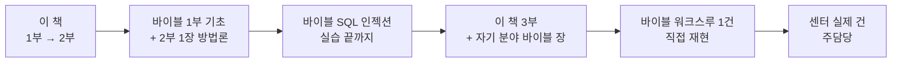

# 공통 역량과 학습 자료

| 레벨 | 상태 | 최종 개정 |
|---|---|---|
| 🟢 | 🔄 개정중 | 2026-10-22 |

> **한눈에 보기**
> 센터 직원에게 필요한 역량은 세 묶음이다. **기술**(재현하고 판단한다), **소통**(조치되게 만든다), **제도**(규칙 안에서 움직이고 규칙을 만든다).
> 역할에 따라 비중이 다르지만 세 묶음 모두 기본은 갖춘다.

## 1. 역량 지도

| 묶음 | 역량 | 기본 (전원) | 심화 (담당자) | 학습 자료 |
|---|---|---|---|---|
| 기술 | 취약점 이해 | 유형·CWE·CVSS 읽기 | 신규 취약점 분석, 변형 탐색 | 제2편 [1부](../../vol2-tech/part1-foundations/01-what-is-vulnerability.md) → [3·4부](../../vol2-tech/part3-web/00-overview.md) |
| 기술 | 재현 | 제보대로 따라 해 보기 | 환경 구축, 패치 diff 읽기, PoC 최소화 | 제2편 [7부 워크스루](../../vol2-tech/part7-walkthroughs/00-overview.md) |
| 기술 | 도구 | 프록시, 스캐너 결과 읽기 | 디버거, 퍼저, SAST 룰 작성 | 제2편 [6부](../../vol2-tech/part6-tools/00-when-to-use-what.md) |
| 기술 | AI 활용 | AI 결과 재검증, 기각 사유 기록 | 프롬프트·워크플로 설계, 유효율 분석 | [2부 9장](../../vol1-center/02-programs/09-ai.md) |
| 소통 | 보고서 | 재현 절차·영향·조치 세 요소 | 독자별 버전, 공지 문안 | 제2편 [8부](../../vol2-tech/part8-reporting/01-report-structure.md) |
| 소통 | 상대별 응대 | 신고자·제조사·기관 구분 | 에스컬레이션, 무응답 대응, 공개 조율 | [2부 5장](../../vol1-center/02-programs/05-bug-bounty.md), [3부 11장](../../vol1-center/03-partners/11-external.md) |
| 소통 | 원내 협업 | 접점 부서와 식별자 공유 | 협의체 운영 | [3부 10장](../../vol1-center/03-partners/10-internal.md) |
| 제도 | 운영 | 신고포상제·상시 신고조치제 절차 | 평가 기준 설계, 예산 | [2부 5·6장](../../vol1-center/02-programs/05-bug-bounty.md) |
| 제도 | 법·국제 | 허용 범위 개념, CVE/CNA | 법제화 논거, 국제 사례 | [3부 12장](../../vol1-center/03-partners/12-legal.md) |

## 2. 추천 학습 순서

## 3. 외부 자료

| 분야 | 자료 | 비고 |
|---|---|---|
| 취약점 체계 | [CWE](https://cwe.mitre.org/), [CVE](https://www.cve.org/), [CVSS 4.0 명세](https://www.first.org/cvss/) | 1차 자료 |
| 공개 정책 | ISO/IEC 29147 (취약점 공개), ISO/IEC 30111 (취약점 처리) | 제도 담당 필독 |
| CNA | [CVE 프로그램 CNA 규칙](https://www.cve.org/ResourcesSupport/AllResources/CNARules) | CNA 업무 담당 |
| 국제 CVD | 미국 CISA VDP 자료, 네덜란드 NCSC CVD 가이드라인 | 2027 제도화 참고 |
| 실습 | [PortSwigger Web Security Academy](https://portswigger.net/web-security), [pwn.college](https://pwn.college/) | 무료 |
| 국내 | [KISA 보호나라](https://www.boho.or.kr/), [사이버 보안 취약점 정보 포털](https://knvd.krcert.or.kr/) | 매일 본다 |

🔎 **내부 확인**: 센터 내부 교육 과정, 외부 교육 지원 제도, 자격증 지원.

## 4. 자기 점검

분기마다 한 번, 역량 지도의 각 줄에 대해 "기본 / 심화 / 해당 없음" 중 하나를 표시한다. 멘토 또는 센터장과 공유하고 다음 분기 학습 목표를 하나 정한다. 🔎 공식 역량 평가와의 연계

## 변경 이력

| 날짜 | 변경 | 기여자 |
|---|---|---|
| 2026-10-21 | 초안 작성 | @anthonynoh5202 |
