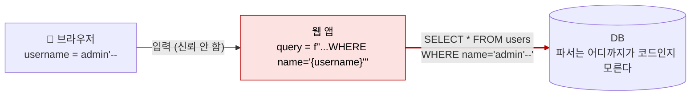
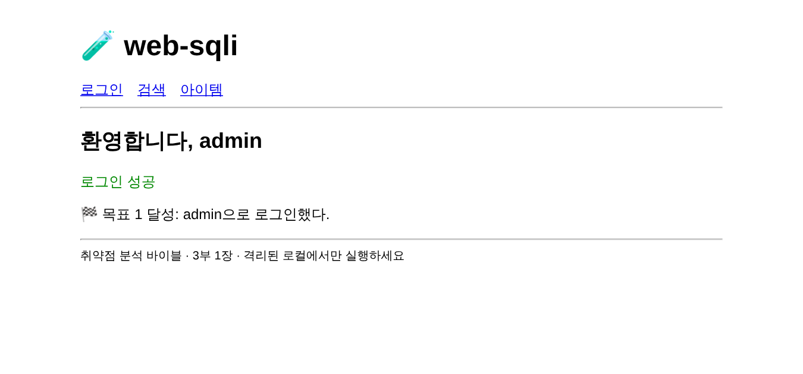
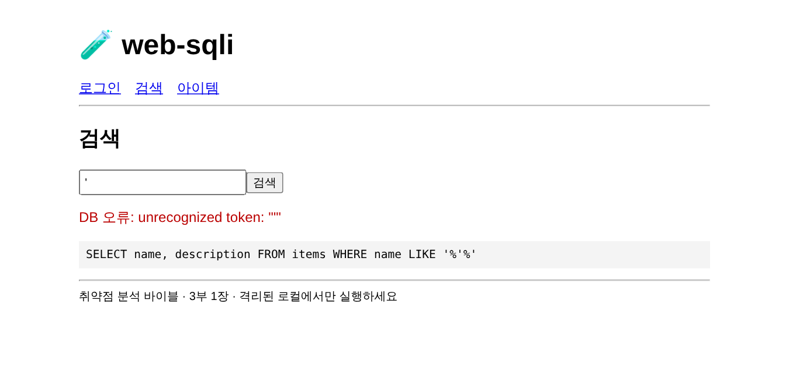
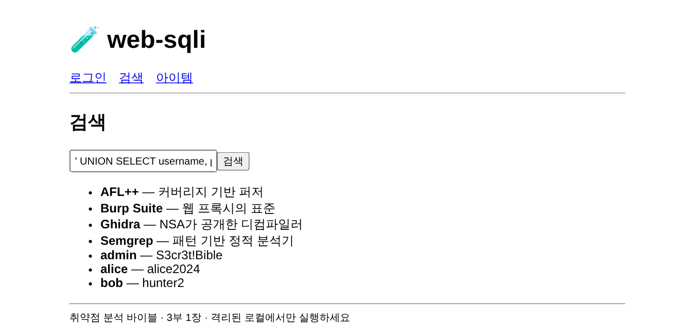
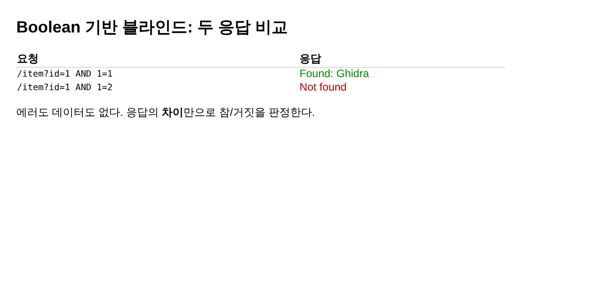
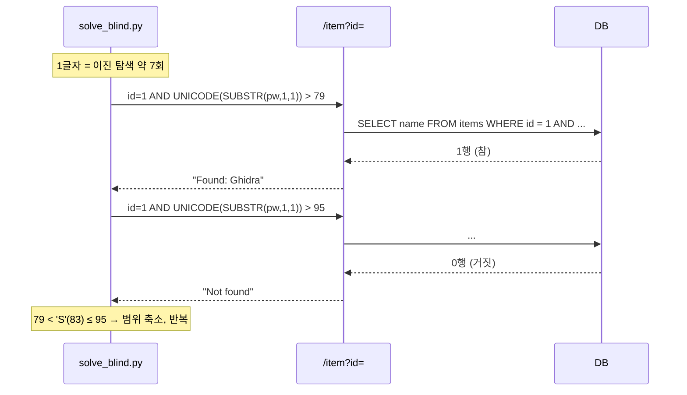

# SQL 인젝션 (SQL Injection)

| 레벨 | 상태 | 최종 개정 | CWE |
|---|---|---|---|
| 🟢 입문 (7절은 🔴) | 🔄 개정중 | 2026-10-21 | [CWE-89](https://cwe.mitre.org/data/definitions/89.html) |

> **한눈에 보기**
> 사용자 입력을 SQL 문자열에 이어 붙이면, 데이터베이스는 그 입력을 "데이터"가 아니라 "명령"으로 읽는다.
> 공격자는 인증을 우회하고, 모든 테이블을 읽고, 경우에 따라 서버 명령까지 실행한다.
> 막는 방법은 하나다. **입력과 쿼리를 분리하라**(파라미터화된 쿼리).

> 📌 이 장은 이 책의 **기준 장(모범 장)**입니다. 다른 취약점 장은 이 장의 구조와 깊이를 기준으로 작성합니다.

## 1. 원리

SQL 인젝션은 **신뢰 경계(trust boundary)** 가 문자열 연결 한 줄에서 무너지는 취약점이다.



<figure>
<figcaption>그림 1. 신뢰 경계는 입력이 쿼리 문자열에 섞이는 웹 앱 안의 한 줄에서 무너진다. 붉은 화살표 이후로는 DB가 모든 것을 코드로 읽는다.</figcaption>
</figure>

데이터베이스는 문자열을 받아 파싱한다. 어디까지가 개발자가 쓴 쿼리이고 어디부터가 사용자 입력인지 구분할 방법이 없다. 따옴표 하나로 문자열 리터럴을 닫으면, 그 뒤는 모두 SQL 문법으로 해석된다.

핵심은 "따옴표를 거르는 것"이 아니다. **입력이 쿼리 파서에 닿기 전에 이미 코드와 분리되어 있어야 한다**는 것이다. 이 원리는 OS 명령 인젝션, LDAP 인젝션, XSS 등 모든 인젝션에 그대로 적용된다.

### 유형

| 유형 | 결과를 어떻게 보는가 | 난이도 |
|---|---|---|
| In-band (Error / Union 기반) | 응답 본문에 데이터나 에러가 그대로 나온다 | 🟢 |
| Blind (Boolean 기반) | 참/거짓에 따라 응답이 달라지는 것만 보인다 | 🟡 |
| Blind (Time 기반) | 응답 시간 차이로만 알 수 있다 | 🟡 |
| Out-of-band | DNS/HTTP 요청을 외부로 보내게 한다 | 🔴 |
| Second-order | 저장된 입력이 나중에 다른 쿼리에서 터진다 | 🔴 |

## 2. 발생하는 코드 패턴

### Python (문자열 포매팅)

```python
# ❌ 취약: f-string으로 쿼리 조립
def login(username, password):
    query = f"SELECT * FROM users WHERE username = '{username}' AND password = '{password}'"
    return db.execute(query).fetchone()
```

```python
# ✅ 안전: 파라미터화된 쿼리
def login(username, password):
    query = "SELECT * FROM users WHERE username = ? AND password = ?"
    return db.execute(query, (username, password)).fetchone()
```

### Java (문자열 연결)

```java
// ❌ 취약
String sql = "SELECT * FROM users WHERE id = " + request.getParameter("id");
Statement st = conn.createStatement();
ResultSet rs = st.executeQuery(sql);
```

```java
// ✅ 안전: PreparedStatement
String sql = "SELECT * FROM users WHERE id = ?";
PreparedStatement ps = conn.prepareStatement(sql);
ps.setInt(1, Integer.parseInt(request.getParameter("id")));
ResultSet rs = ps.executeQuery();
```

### ORM을 써도 생기는 경우

```python
# ❌ 취약: ORM의 raw 쿼리에 문자열 포매팅
User.objects.raw(f"SELECT * FROM users WHERE name = '{name}'")

# ❌ 취약: 정렬 컬럼명을 그대로 넣음 (파라미터 바인딩이 불가능한 위치)
f"SELECT * FROM users ORDER BY {sort_column}"

# ✅ 안전: 허용 목록으로 제한
ALLOWED = {"name", "created_at"}
if sort_column not in ALLOWED:
    raise ValueError
```

> 🟡 **파라미터 바인딩이 안 되는 위치**가 있다. 테이블명, 컬럼명, `ORDER BY` 방향, `LIMIT` 값(일부 DB). 이런 곳은 **허용 목록(allowlist)** 으로만 막을 수 있다.

## 3. 탐지 방법

### 3.1 코드 리뷰 / 정적 분석

**grep으로 시작한다.** 쿼리 문자열 안에 변수 보간이 있는지 본다.

```bash
# Python
grep -rnE "(execute|raw|executescript)\s*\(\s*f?[\"'].*(\{|%s|\+)" --include='*.py' .
# Java
grep -rnE "(executeQuery|execute|prepareStatement)\s*\(.*\+" --include='*.java' .
# PHP
grep -rnE "(mysqli_query|->query|pg_query)\s*\(.*\\\$" --include='*.php' .
```

**Semgrep 룰** (공식 레지스트리에 이미 있다):

```bash
semgrep --config p/sql-injection .
```

직접 쓰면 이런 형태다.

```yaml
rules:
  - id: python-sqli-fstring
    languages: [python]
    severity: ERROR
    message: SQL 쿼리에 f-string 사용. 파라미터화된 쿼리로 바꾸세요.
    patterns:
      - pattern: $DB.execute(f"...", ...)
```

**CodeQL**은 소스(요청 파라미터)에서 싱크(쿼리 실행)까지 흐름을 추적한다. 기본 쿼리 `py/sql-injection`, `java/sql-injection`을 쓴다.

**리뷰할 때 보는 순서**

1. DB 실행 함수를 전부 찾는다 (싱크).
2. 각 호출의 쿼리 문자열이 리터럴인지, 조립된 것인지 본다.
3. 조립된 것이면 어떤 변수가 들어가는지, 그 변수가 사용자 입력에서 왔는지 거슬러 올라간다 (소스).
4. 중간에 검증/이스케이프가 있어도 **그 위치에서 유효한지** 확인한다 (컬럼명 위치에 이스케이프는 무의미).

### 3.2 동적 테스트

**1단계: 따옴표 하나**

모든 입력 파라미터에 `'` 하나를 넣는다. 500 에러, DB 에러 메시지, 응답 변화 중 하나라도 있으면 후보다.

**2단계: 참/거짓 비교**

| 입력 | 쿼리 결과 | 기대 |
|---|---|---|
| `1' AND '1'='1` | 참 | 정상 응답 |
| `1' AND '1'='2` | 거짓 | 빈 응답 또는 다른 응답 |

두 응답이 다르면 Boolean 기반 블라인드 인젝션이 확인된 것이다.

**3단계: 시간 지연**

응답 차이가 없을 때. DB별 문법이 다르다.

| DB | 페이로드 |
|---|---|
| MySQL | `' AND SLEEP(5)-- ` |
| PostgreSQL | `'; SELECT pg_sleep(5)-- ` |
| MSSQL | `'; WAITFOR DELAY '0:0:5'-- ` |
| SQLite | `' AND 1=LIKE('ABCDEFG',UPPER(HEX(RANDOMBLOB(300000000))))-- ` |

**자동화**: 후보가 확인된 뒤 `sqlmap`으로 범위를 확인한다. 자동화 도구는 "있다/없다"를 넓게 찾고, 사람은 "어디까지 가능한가"를 깊게 본다.

```bash
sqlmap -u "http://localhost:8080/login" --data="username=a&password=b" -p username --batch
```

## 4. 실습 🧪

실습 환경: [`labs/web-sqli/`](https://github.com/anthonynoh5202/anthonynoh/tree/main/labs/web-sqli)

```bash
cd labs/web-sqli
docker compose up --build
# http://localhost:8080
```

**목표**: 비밀번호 없이 `admin`으로 로그인하고, `users` 테이블의 모든 행을 읽는다.

### 4.1 인증 우회

1. 로그인 폼에 `username=admin'-- `, `password=아무거나` 를 넣는다.
2. 조립된 쿼리는 이렇게 된다.
   ```sql
   SELECT * FROM users WHERE username = 'admin'-- ' AND password = '아무거나'
   ```
   `--` 뒤는 주석이므로 비밀번호 조건이 사라진다.
3. `admin`으로 로그인되면 성공.

<figure>

<figcaption>그림 2. 성공하면 이 화면이 보인다. 비밀번호 조건이 주석 처리되어 사라졌다.</figcaption>
</figure>

### 4.2 UNION으로 데이터 추출

1. 검색 기능 `/search?q=`에 `'`를 넣어 에러를 확인한다.
2. 컬럼 수를 찾는다. `' ORDER BY 1-- `, `' ORDER BY 2-- `, ... 에러가 나는 직전 숫자가 컬럼 수.
3. `' UNION SELECT username, password FROM users-- ` 로 모든 계정을 읽는다.

<figure>

<figcaption>그림 3. 1단계. 따옴표 하나에 DB 오류가 그대로 나온다. 조립된 쿼리까지 보여 주는 것은 실습용이고, 실제 서비스는 보통 500 에러만 낸다.</figcaption>
</figure>

<figure>

<figcaption>그림 4. 3단계. 검색 결과 목록 끝에 <code>users</code> 테이블의 내용이 붙어 나온다.</figcaption>
</figure>

### 4.3 블라인드로 추출 (심화 🟡)

`/item?id=` 엔드포인트는 에러도, 데이터도 보여주지 않는다. 참/거짓만 다르다.

<figure>

<figcaption>그림 5. 두 요청의 응답 차이. 이 차이 하나로 한 글자씩 비밀번호를 뽑아낸다.</figcaption>
</figure>



<figure>
<figcaption>그림 6. Boolean 기반 블라인드 추출의 흐름. 응답 본문은 두 종류뿐이지만, 질문을 잘 고르면 어떤 값이든 읽어낼 수 있다.</figcaption>
</figure>

1. `1 AND (SELECT SUBSTR(password,1,1) FROM users WHERE username='admin')='a'` 를 넣는다.
2. 응답이 "참"이면 첫 글자는 `a`. 아니면 다음 글자를 시도한다.
3. 이걸 스크립트로 자동화한다. `labs/web-sqli/solve_blind.py`에 참고 구현이 있다.

### 4.4 고치기

`labs/web-sqli/app/app.py`의 `❌` 표시된 함수를 파라미터화된 쿼리로 바꾸고, 4.1~4.3이 모두 실패하는지 확인한다. **고치는 것까지가 실습이다.**

## 5. 익스플로잇 검증

보고서에 "SQL 인젝션 존재"라고만 쓰면 심각도를 판단할 수 없다. 실습 환경 안에서 다음을 순서대로 확인한다.

| 단계 | 확인 | 심각도에 미치는 영향 |
|---|---|---|
| 1 | 에러 또는 참/거짓 차이가 있다 | 취약점 존재 확인 |
| 2 | 다른 테이블의 데이터를 읽을 수 있다 | 기밀성 침해. 보통 High |
| 3 | 데이터를 수정/삭제할 수 있다 (`UPDATE`, `DELETE`, 스택 쿼리) | 무결성 침해. High~Critical |
| 4 | 파일 읽기/쓰기, 명령 실행 (`LOAD_FILE`, `xp_cmdshell`, `COPY TO`) | 서버 장악. Critical |

2단계까지만 증명해도 영향 판단에는 충분한 경우가 많다. **3, 4단계는 허가받은 범위 안에서만** 한다. 실제 서비스에서 `DROP`이나 파일 쓰기를 시도하는 것은 허가 범위를 넘는 경우가 대부분이다.

## 6. 방어

| 계층 | 조치 | 효과 |
|---|---|---|
| 코드 | **파라미터화된 쿼리** (Prepared Statement) | 근본 제거. 이것 하나면 끝난다 |
| 코드 | 식별자(테이블·컬럼명)는 허용 목록 | 바인딩 불가 위치 방어 |
| 프레임워크 | ORM 사용, raw 쿼리 금지 린트 | 기본값으로 차단 |
| 인프라 | DB 계정 최소 권한 (읽기 전용 계정 분리, `FILE` 권한 제거) | 피해 범위 축소 |
| 인프라 | WAF | 자동화 공격 지연. **우회 가능하므로 유일한 방어로 쓰지 않는다** |
| 탐지 | DB 에러 로그, 비정상 쿼리 패턴 알림 | 사후 대응 |

**하지 말아야 할 것**

- 블랙리스트 필터 (`'`, `--`, `UNION` 차단). 인코딩, 대소문자, 주석(`UN/**/ION`)으로 우회된다.
- "이스케이프만 하면 된다"는 생각. 문자열 위치에서만 유효하고, 멀티바이트 인코딩에서 깨지는 경우가 있다.

## 7. 우회 기법 🔴

방어가 불완전할 때 공격자가 쓰는 기법. **왜 블랙리스트가 안 되는지**를 이해하기 위해 읽는다.

| 방어 | 우회 |
|---|---|
| 공백 차단 | `/**/`, `%09`, `%0a`, 괄호 `UNION(SELECT(1))` |
| `UNION` 키워드 차단 | 대소문자 혼합, 인라인 주석 `UN/**/ION` (MySQL), 중복 삽입 `UNUNIONION` |
| 따옴표 차단 | 숫자 컨텍스트 이용, `CHAR(97,100,109,105,110)`, 16진수 `0x61646d696e` |
| 주석 `--` 차단 | `#` (MySQL), `/*`, 또는 `' OR '1'='1` 처럼 주석 없이 닫기 |
| `=` 차단 | `LIKE`, `IN`, `BETWEEN`, `REGEXP` |
| WAF 시그니처 | HTTP 파라미터 오염, 청크 인코딩, 멀티파트 경계 변형 |
| `addslashes` 이스케이프 | GBK 등 멀티바이트 문자셋에서 `%bf%27` → `縗'` (CVE-2006-2753 계열) |

Second-order 인젝션은 **방어 위치를 잘못 잡은** 경우다. 회원가입 시 이스케이프한 `admin'-- `가 DB에 그대로 저장되고, 나중에 비밀번호 변경 쿼리에서 그 값을 다시 문자열 연결로 쓰면 터진다. 저장 시점이 아니라 **모든 쿼리 시점**에 파라미터화해야 하는 이유다.

## 8. 실제 CVE 사례

| CVE | 제품 | 핵심 | 패치 |
|---|---|---|---|
| [CVE-2023-34362](https://nvd.nist.gov/vuln/detail/CVE-2023-34362) | Progress MOVEit Transfer | 인증 없는 SQLi → 웹셸 배포. Cl0p 랜섬웨어 그룹이 수백 조직 대량 공격 | 벤더 권고 [링크](https://community.progress.com/s/article/MOVEit-Transfer-Critical-Vulnerability-31May2023) |
| [CVE-2024-3400](https://nvd.nist.gov/vuln/detail/CVE-2024-3400) | Palo Alto PAN-OS GlobalProtect | 명령 인젝션 (SQLi 아님). SQLi와 같은 "입력이 명령에 섞이는" 원리의 자매 사례로 비교용 | [권고](https://security.paloaltonetworks.com/CVE-2024-3400) |
| [CVE-2019-9193](https://nvd.nist.gov/vuln/detail/CVE-2019-9193) | PostgreSQL `COPY TO/FROM PROGRAM` | SQLi가 명령 실행으로 이어지는 경로. 벤더는 "기능"이라 반박. 5절 4단계의 대표 사례 | [PostgreSQL 입장](https://www.postgresql.org/about/news/cve-2019-9193-not-a-security-vulnerability-1935/) |
| [CVE-2017-8917](https://nvd.nist.gov/vuln/detail/CVE-2017-8917) | Joomla! 3.7.0 | `ORDER BY` 위치의 인젝션. 2절 "바인딩 불가 위치"의 실제 예 | [패치 커밋](https://github.com/joomla/joomla-cms/commit/4a39c20) |
| [CVE-2012-2122](https://nvd.nist.gov/vuln/detail/CVE-2012-2122) | MySQL / MariaDB | 인젝션은 아니지만 인증 우회. `memcmp` 반환값 캐스팅 오류로 1/256 확률로 로그인. "DB 자체의 취약점"도 있음을 보여줌 | [분석](https://seclists.org/oss-sec/2012/q2/493) |

**MOVEit (CVE-2023-34362) 에서 배울 것**: 패치 diff는 공개되지 않았지만, 분석 보고서에 따르면 인증 전 단계의 세션 처리에서 사용자 제어 값이 SQL 문자열에 들어갔다. 취약점 자체는 교과서적인 SQLi였고, 심각도를 Critical로 만든 것은 (1) 인증 불필요 (2) 인터넷 노출 (3) 파일 전송 제품이라 데이터가 바로 거기 있음, 세 가지 **맥락**이었다. [8부 2장 영향도 산정](../part8-reporting/02-severity.md)의 핵심 논지다.

**Joomla (CVE-2017-8917) 에서 배울 것**: 패치는 `ORDER BY` 컬럼명을 허용 목록으로 검사하도록 바꿨다. 파라미터 바인딩이 불가능한 위치에서 유일하게 작동하는 방어다.

## 9. 체크리스트

**코드 리뷰할 때**
- [ ] 모든 DB 실행 함수 호출에서 쿼리 문자열이 리터럴인가?
- [ ] 조립된 쿼리가 있다면 모든 변수가 바인딩되는가?
- [ ] 테이블명·컬럼명·정렬 방향이 입력에서 오는가? 허용 목록이 있는가?
- [ ] ORM `raw()`, `extra()`, `execute()` 호출이 있는가?
- [ ] 저장된 값을 다시 쿼리에 쓰는 곳이 있는가? (second-order)

**테스트할 때**
- [ ] 모든 파라미터(쿼리스트링, 폼, 헤더, 쿠키, JSON 필드)에 `'` 를 넣어 봤는가?
- [ ] 에러가 없을 때 참/거짓, 시간 지연을 시도했는가?
- [ ] 숫자 파라미터에도 시도했는가? (`id=1 OR 1=1`)

**배포 전**
- [ ] DB 계정이 애플리케이션에 필요한 최소 권한만 갖는가?
- [ ] DB 에러 메시지가 사용자에게 노출되지 않는가?
- [ ] SAST(Semgrep/CodeQL)가 CI에 있고 SQLi 룰이 켜져 있는가?

## 10. 더 읽기

- [CWE-89](https://cwe.mitre.org/data/definitions/89.html) · 공식 정의와 하위 유형
- [OWASP SQL Injection Prevention Cheat Sheet](https://cheatsheetseries.owasp.org/cheatsheets/SQL_Injection_Prevention_Cheat_Sheet.html) · 언어별 안전한 코드
- [PortSwigger Web Security Academy: SQL injection](https://portswigger.net/web-security/sql-injection) · 무료 실습 랩, 이 장 다음에 바로 가기 좋다
- [PayloadsAllTheThings: SQL Injection](https://github.com/swisskyrepo/PayloadsAllTheThings/tree/master/SQL%20Injection) · DB별 페이로드 모음 (실습 환경에서만)
- [sqlmap 공식 문서](https://github.com/sqlmapproject/sqlmap/wiki)

## 변경 이력

| 날짜 | 변경 | 기여자 |
|---|---|---|
| 2026-10-21 | 초안 작성. 기준 장으로 지정 | @anthonynoh5202 |
| 2026-10-21 | 다이어그램 2개(Mermaid), 실습 스크린샷 4장 추가 | @anthonynoh5202 |
